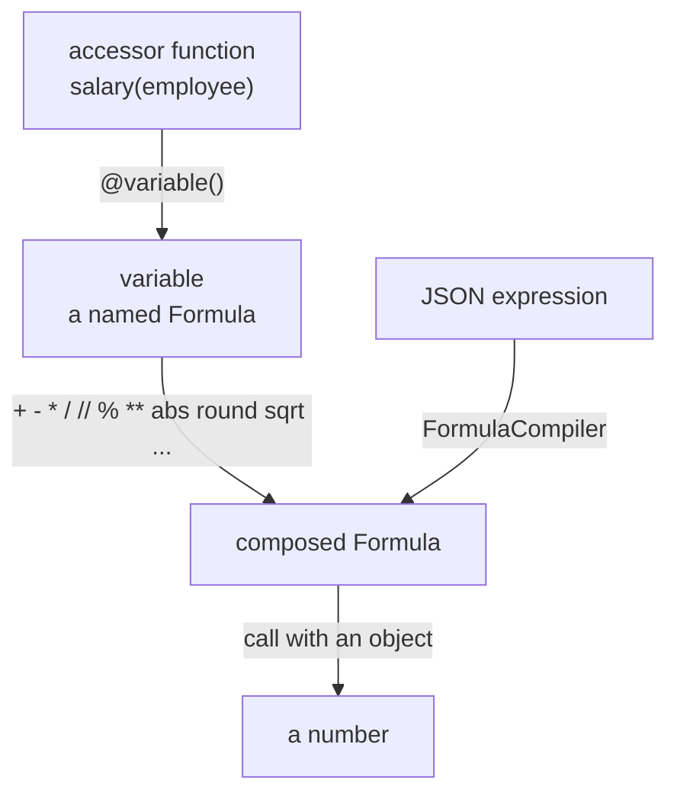

# User guide

pyformula has a handful of pieces. Each page covers one of them with examples you can
paste and run (every `python` block in these docs is executed by the test suite).

| Piece | What it is | Page |
| --- | --- | --- |
| `Formula` | a callable `T -> number` that composes with arithmetic operators | [Formulas](formulas.md) |
| `variable`, `VariablesRegistry` | named formulas read from your objects | [Variables and registries](variables.md) |
| `pyformula.math` | `sqrt`, `log10`, `ceil`, trigonometry and more, as formulas | [Math functions](math.md) |
| `round()`, `Decimal` | exact money arithmetic and rounding | [Numbers, Decimal and rounding](numbers.md) |
| `FormulaCompiler` | JSON expressions to formulas | [Compiling formulas from JSON](compiling.md) |
| `get_formula_json_schema` | JSON Schema of the expressions a compiler accepts | [JSON Schema](json-schema.md) |
| pyspecification | choosing **which** formula applies | [With pyspecification](pyspecification.md) |

## The mental model

1. You write small **accessor functions** that read one number from an object.
2. `@variable()` (or a registry) turns each into a named **formula**.
3. Formulas **compose** with Python operators, numbers and math functions into bigger
   formulas. Nothing is calculated yet.
4. Calling a formula with an object **evaluates** it and returns a number.

A formula is immutable: every operator returns a new formula, so you can reuse `salary`
in as many calculations as you like.
